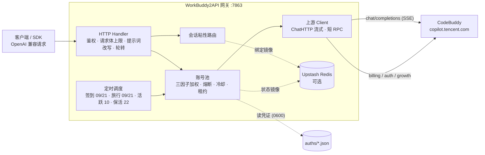

<p align="center">
  
</p>

<h1 align="center">WorkBuddy2API</h1>

<p align="center">
  <b>把 WorkBuddy / Qoder / Loomy 账号变成 OpenAI 兼容 API 的多上游网关</b><br>
  三上游混合调度 · 账号池轮转 · 熔断与冷却 · 会话粘性 · 积分签到
</p>

<p align="center">
  
  
  
  
  <a href="https://t.me/sliverkiss_blog"></a>
</p>

---

## 项目简介

WorkBuddy2API 是一个自托管的 **OpenAI 兼容反向代理网关**，把 ```WorkBuddy（CodeBuddy）```、```Qoder```、```Loomy（讯飞）``` 三类账号统一包装成 `/v1/chat/completions` 服务。

- 三家的官方形态都不开放标准 OpenAI API，本项目在网关侧原生实现各自的登录协议，并做 token 自动刷新（Loomy 无 refresh token，用手机号+密码重登续期）、账号池调度与流量治理；
- **同一入口混合调度**：裸模型名先按 `priority` 分档（数值大者先试，Loomy 默认 2），档内按 `weight` 加权；某档账号全部冷却 / 积分耗尽时自动回落到下一档——所以「deepseek 先走 Loomy，用完了再走其它」只是一份别名配置；
- 面向 **个人多账号** 场景：多账号共享、单号故障自动换号、冷却 / 熔断防止雪崩、会话粘性保证多轮上下文不跳号；每个上游有独立账号池与独立状态文件，互不影响；
- 对客户端只暴露 OpenAI 兼容接口，现有 SDK / 前端 / 工具 **零改造接入**；同一套 Web 面板管理三家的加号、签到、余额与成本账本。

> ⚠️ 合规须知：本项目是**非官方**网关，使用自有授权账号作为上游，**仅限本人授权账号、本机 / 私有环境测试**。详细边界见[安全与合规](#安全与合规)。

📖 完整文档见 [GitHub Wiki](https://github.com/Sliverkiss/workbuddy2api/wiki)。

## 核心能力

### 账号池治理

- **OAuth 设备授权登录** — `login.sh` 一条命令完成：取授权 URL → 浏览器登录 → token 轮询 → 凭证落盘 → 重启加载，全程无 PKCE（state 由服务端签发），重复执行即可连续添加多账号
- **四因子加权随机选号** — `credits 比例 ×10 + 闲置补偿 + 成功率 ×3 + 快过期积分占比 ×8` 四项加权（`pool.expiring_soon` 窗口内的积分优先消耗，默认 7 天），按权重降序取 **Top-5 候选短名单**，再在短名单内加权抽签（等权重候选先随机打乱防惊群、LRU 兜底覆盖全部候选），兼顾积分多、闲置久、成功率高、快过期积分先用掉的账号
- **防惊群** — 跳过 100ms 内刚被选中的账号，多账号同时待命时不打爆同一台
- **在途租约** — 单账号最大在途请求数（`pool.max_in_flight`）限制并发占用，占满的号不参与选号，避免单号过载
- **账本择优** — 每次成功请求按 `usage.credit` 折算每千 token 单价记入 `(账号, 模型)` 账本，免费 / 便宜的账号优先；观测按 EMA 平滑、6 小时未更新即失效，成本随上游活动实时变化

### 流量治理

- **分级熔断与冷却** — 429 软冷却（600s 起指数退避、封顶 `soft_rate_max`）、404 固定浅冷却、402 / 余额耗尽硬冷却至次日 04:00、连续失败熔断（`breaker_threshold` 触发后指数退避封顶 6h）
- **模型级限流独立冷却** — 6004（该模型使用量超限）只冷却触发调用的模型，切其他模型立即可用；`/status` 透出 `rate_limited_models` 台账
- **状态持久化** — 池状态（积分 / 冷却 / 熔断 / 计数）本地原子落盘 `state.json`，可选镜像至 Upstash Redis，重启后择优恢复

### 请求链路

- **流式 + 非流式** — 出站强制 `stream:true`；SSE 帧按 OpenAI 规范白名单重建；非流式由本地聚合为单响应
- **DeepSeek 思维链注入** — 出站请求体注入 `thinking.type=enabled` + 默认档位，`reasoning_content` 多轮回填，`reasoning_effort` 按模型档位自动降级
- **系统提示词体系** — 默认透传客户端原始 system（`passthrough` 模式，缺省），仅自定义配置 `custom` 时网关用自有提示词替换客户端 system/developer（从源头消除模板句误报）；`passthrough` 模式遇拦截自动降级中性提示词重试
- **会话头族注入** — 出站携带官方客户端会话头族（`X-Conversation-Request-ID` 聚合主键 · `X-Conversation-ID` 透传 · B3 链路），轮转 / 重试 / 路径回退复用同键，后台按对话轮聚合不再碎片化（issue #35）
- **指纹脱敏** — 出站请求体黑名单指纹字段清洗（可开关），与提示词体系两层叠加

### 定时积分任务

- **签到**（09 / 21 点）— 每日签到 + 余额查询，余额恢复自动解冻冷却账号
- **活跃上报**（10 点）— 对话事件连发上报，点亮连登天数、解锁领养前置，回读 streak 自检
- **猫猫旅行**（09 / 21 点）— 独立排程：领养 / 派出 / 领奖闭环推进
- **token 保活**（22 点）— 全账号刷新 token，session 失效连续 3 次才禁用
- **开学季任务**（12 点）— 任务点亮 + claim + 自动抽空抽奖余额，活动下线时自动跳过
- **夜猫子任务**（01 点）— 夜猫窗口（23:00–08:00 CST）内补一次 black_cat 任务

六类任务独立排程、独立开关（`schedule.*_enabled`），互不影响。

### 双域适配

- 同时适配**国内版（CN，`copilot.tencent.com` / `www.codebuddy.cn`）与国际版（Global，`www.workbuddy.ai`）**账号
- 共享同一账号池，由账号 `realm` 或请求模型名前缀（`cn:` / `global:`）决定路由；`global.enabled` 可一键锁死纯 CN 部署
- 国际版支持注册激活、地区完善、一次性 trial 加油包领取（`./trial.sh`）

### Qoder 第二上游（可选）

- **同一入口混合调度** — 开启 `qoder.enabled` 后，同一 `/v1/chat/completions` 可按模型在多个上游间调度：裸模型名（如 `deepseek-v4-pro`）在各方目录归一化匹配后按调度档位（`priority` 分档 + 档内 `weight` 加权）选择 Provider，某档全不可用时自动降级到下一档；`qoder:<model>` 强制 Qoder、`cn:<model>` / `global:<model>` 强制 WorkBuddy 对应域
- **独立账号池** — Qoder 账号走独立池（`qoder.state_file`），冷却 / 熔断 / 在途租约与 WorkBuddy 池互不影响；账号文件为 `<auth_dir>/qoder-*.json`，与 qoder2api-hub 账号文件同形状、可直接互读
- **三种接入** — 面板内可设备授权登录（PKCE）、导入 `pt-` 个人访问令牌、粘贴/上传账号 JSON；token 过期自动刷新（`drt-` / `jrt-` / `pt-` 分别走 deviceToken / jobToken 刷新与交换）
- **纯 Go 协议实现** — COSY 签名（AES-128-CBC + RSA PKCS#1 v1.5 + MD5）、设备指纹、SSE 信封解包全部原生实现，无 Python 运行时依赖
- **运营能力** — 每日签到 / 活动任务领取 / `checkin_when_disabled` / 批量签到；余额与额度详情（面板 Qoder 积分、消耗明细、定时刷新）；定时 token 保活
- **防风控** — 每账号并发闸门 + 请求最小间隔 + 抖动，排队超时 fail-open；`/healthz` 透出 `risk` 排队遥测
- **多协议入口** — 除 OpenAI `/v1/chat/completions` 外，原生支持 Anthropic `/v1/messages`（含 `count_tokens`）与 OpenAI Responses API `/v1/responses`，流式均逐事件转换
- **附加能力** — 网关本地 `web_search` / `web_fetch`（SSRF 防护、TTL 缓存、多轮回灌）；内联大 PNG 无损重压；峰谷价 / 上下文窗口 / 思考档位元数据；面板「智能体配置」一键把 Claude Code、Codex、OpenCode、DSH、Crush 等客户端指向本网关（写入前备份、可 byte-exact 还原）

### Loomy 第三上游（可选）

- **混合调度 + 优先级** — 开启 `loomy.enabled` 后，同一 `/v1/chat/completions` 可在三个上游间调度。裸模型名按 `priority` 分档（数值大者先试），档内按 `weight` 加权；某一档的账号全部冷却/积分耗尽时，轮转循环自动落到下一档——这就是「deepseek 优先走 Loomy，Loomy 用完再走其它」的实现方式。`loomy:<model>` 强制 Loomy
- **独立账号池** — Loomy 账号走独立池（`loomy.state_file`），冷却 / 熔断 / 在途租约与另外两池互不影响；账号文件为 `<auth_dir>/loomy-*.json`
- **纯 Go 协议实现** — 账号服务 HMAC-SHA1 签名、RSA PKCS#1 v1.5 口令加密、14 天 session、模型网关 OpenAI 兼容 SSE，全部原生实现，无 Python 运行时依赖
- **自动签到 + 自动任务** — 每日 `/points/first-login` 刷新日赠送积分，并按 `loomy.onboarding_enabled`（默认开）领取 8 项新手任务（共 10000 分）；领取前后各回读一次状态，未确认的进 `pending` 而不是假装成功
- **会话续期** — Loomy 没有 refresh token，续期等价于重新登录：账号文件保存手机号 + 密码（0600），签到前与会话剩余不足 `session_renew_before_days` 天时自动重登
- **成本记账** — 上游 SSE 里的 `usage.points_consumed` 就地映射为 `usage.credit`，面板积分/成本账本与另两个上游同一口径

接入账号（Web 面板）：打开 `/panel/` → 账号页「+ 添加账号」→ 选 **Loomy** → 填手机号、密码（可选备注）→「登录并添加」。登录成功后账号立即落盘、入池，并顺手查一次余额；同一手机号再添加一次即为重新登录（沿用设备指纹，不会产生重复账号）。该页也支持粘贴 `loomy-*.json`（单个对象 / 数组 / `{"accounts":[...]}`）批量导入。

Loomy 没有 refresh token，14 天后靠这对手机号 + 密码重新登录续期，所以密码会写入账号文件（权限 0600），面板只回显脱敏手机号。

面板不可达的服务器可用 CLI（与面板同一条实现）：

```bash
# 首次登录 / 重复运行即续期（手机号 + 密码 → loomy-<uid>.json）
LOOMY_PASSWORD='***' go run ./cmd/loomylogin --phone 13800000000 --dir ./loomy_auths
```

`/v1/models` 合并三侧目录：同名模型只保留一条裸名（`owned_by: "merged"`，附带 `workbuddy_model` / `qoder_key` / `loomy_key` 说明实际落点），各家独有模型分别以 `qoder:<display_name>`、`loomy:<id>` 暴露；`/status` 的 `providers` 段分别给出各上游 total / healthy / cooling / disabled。

### 辅助工具

- 积分日报：`./credit.sh`（美化 / `-json`，realm 感知双域）
- 手动签到：`./signin.sh`（批量、幂等不重复计）
- 领养联动 / 任务查询：`scripts/task_runner.py`（成长任务一体机，默认 dry-run）
- 个性化提示词：`prompt.file` 指向自定义提示词文件即整体替换内置默认

## 架构总览



上游请求在出站前经历统一的改写管线（`internal/upstream/payload.go`）：强制 `stream:true`、`developer` 角色归一、tool_choice 归一、DeepSeek 思维链注入、`reasoning_effort` 档位降级、`reasoning_content` 回填、指纹脱敏。

## 快速开始

### 环境要求

- **Docker + Docker Compose**（推荐部署方式，镜像内已含 `app` 低权限用户与全部工具脚本）
- 一个或多个已注册的 CodeBuddy 账号，用于 OAuth 登录
- 宿主机 Go ≥ 1.22（仅源码构建时需要）

### Docker Compose 一键部署

```bash
git clone https://github.com/Sliverkiss/workbuddy2api.git
cd workbuddy2api
cp config.example.json config.json
```

编辑 `config.json`，**至少设置 `api_key`**（`留空 = 不鉴权`，公网部署务必设置）。示例中的 `test_key` 等均为占位符，`config.example.json` 不含任何真实密钥。

可选启用 Qoder 第二上游（默认关闭，纯 WorkBuddy 部署零变化）：

```json
"qoder": { "enabled": true, "auth_dir": "./qoder_auths", "state_file": "./data/qoder_state.json", "weight": 1.0 }
```

启用后在面板「添加账号」选择 Qoder，通过设备授权 / PAT / 账号 JSON 导入账号，或直接放置 `qoder_auths/qoder-<uid>.json` 后重启。

新增可选项（默认值见 `config.example.json`）：

```json
"qoder": {
  "enabled": true,
  "guard": { "enabled": true, "max_concurrency": 1, "min_gap_ms": 400, "max_wait_ms": 20000, "jitter_ms": 120 },
  "web_tools": false,
  "image_transcode": true,
  "anthropic_thinking": "off",
  "pricing_file": ""
}
```

- `guard`：每账号并发闸门与节奏控制，防止短时间打爆同一账号触发风控。
- `web_tools`：仅对 `qoder:<model>` 强路由生效；客户端声明内置 `web_search` / `web_fetch` 时由网关代跑（DDG → Bing → Wikipedia），最多 3 轮回灌。
- `anthropic_thinking`：`/v1/messages` 的 thinking 模式，默认 `off` 不透传。
- `pricing_file`：可选价格覆盖（USD / 1M tokens），仅用于元数据与估算，不参与结算。
- `aliases`：两侧模型叫法不同时仍可按同一个裸名混合调度。键是网关对外裸名，值是各上游真实模型名：

```json
"aliases": {
  "deepseek-flash": {
    "workbuddy": "deepseek-v4.1-flash",
    "qoder": "DeepSeek-Flash",
    "loomy": "deepseek-v4-flash-0731"
  }
}
```

配置后请求 `model: "deepseek-flash"` 即可：裸名按调度档位选择 Provider（`loomy.priority` 默认 2 → Loomy 先试），选中 Loomy 时出站改写为 `deepseek-v4-flash-0731`，Qoder 改写为 `DeepSeek-Flash`，WorkBuddy 改写为 `deepseek-v4.1-flash`；一侧无可用账号/模型/积分时自动降级到下一档。`/v1/models` 也会以 `owned_by: "merged"` 暴露该裸名。强制路由 `qoder:` / `loomy:` / `cn:` / `global:` 仍然有效。

Loomy 段配置（`config.example.json` 有完整示例）：

```json
"loomy": {
  "enabled": true,
  "auth_dir": "./loomy_auths",
  "state_file": "./data/loomy_state.json",
  "priority": 2,
  "weight": 1.0,
  "checkin_hours": [9, 21],
  "onboarding_enabled": true
}
```

- `priority`：裸名调度的档位，数值大者先试；缺省 2 = 永远优先。设 0/1 与其它上游平级按 `weight` 抽签，负数 = 不参与裸名调度（仅 `loomy:` 前缀可用）。
- `checkin_hours` / `keepalive_hours`：Loomy 独立排程，默认 9/21 点签到、22 点会话续期；`checkin_enabled` / `keepalive_enabled` 分别关闭。
- `onboarding_enabled`：签到同时领取新手任务（共 10000 分），默认开。

Anthropic / Responses 入口与 OpenAI 入口共用同一鉴权（`Authorization: Bearer` 或 `x-api-key`）与账号轮转：

```bash
curl -s http://localhost:7863/v1/messages \
  -H "x-api-key: your-api-key" -H "anthropic-version: 2023-06-01" \
  -d '{"model":"qoder:DeepSeek-V4-Pro","max_tokens":256,"messages":[{"role":"user","content":"hi"}]}'

curl -s http://localhost:7863/v1/responses \
  -H "Authorization: Bearer your-api-key" \
  -d '{"model":"deepseek-v4-pro","input":"hi"}'
```

面板「智能体配置」页可检测本机已安装的 AI 客户端（只读探测命令 / 配置目录 / IDE 扩展），并一键接入或还原；API Key 只写入客户端本地配置，网关 state 仅存 sha256。

```bash
# 登录添加账号（重复执行可加多号）
./login.sh

# 启动服务
docker compose up -d --build

# 健康检查（无可用账号时 503）；service 字段用于确认打到的是本网关
curl -s http://localhost:7863/healthz
# {"healthy":2,"total":3,"service":"workbuddy2api"}
```

`login.sh` 内置授权 URL 获取 + 浏览器登录 + token 轮询 + 首次签到 + `auths/workbuddy-<uid>.json` 落盘 + 容器重启，全程无 PKCE（state 由服务端签发）。账号池在容器启动时用 `auths/` 目录自动对齐，新增凭证文件即自动发现。

### 源码构建

```bash
go build ./...
go vet ./...
go test ./...      # 完整测试套件
go run ./cmd/server -config config.json
```

构建二进制：

```bash
CGO_ENABLED=0 go build -trimpath -ldflags="-s -w" -o wb2api ./cmd/server
CGO_ENABLED=0 go build -trimpath -ldflags="-s -w" -o signin_bin ./cmd/signin
CGO_ENABLED=0 go build -trimpath -ldflags="-s -w" -o login ./cmd/login
CGO_ENABLED=0 go build -trimpath -ldflags="-s -w" -o credit ./cmd/credit
```

### 验证

```bash
# 模型列表
curl -s http://localhost:7863/v1/models -H "Authorization: Bearer your-api-key"

# 账号状态（汇总 + 每账号详情，disabled 账号透出 disabled_reason）
curl -s http://localhost:7863/status -H "Authorization: Bearer your-api-key"

# 流式聊天
curl -sN http://localhost:7863/v1/chat/completions \
  -H "Authorization: Bearer your-api-key" \
  -H "Content-Type: application/json" \
  -d '{"model":"deepseek-v4-flash","messages":[{"role":"user","content":"hi"}],"stream":true}'

# 非流式聊天（本地聚合）
curl -s http://localhost:7863/v1/chat/completions \
  -H "Authorization: Bearer your-api-key" \
  -H "Content-Type: application/json" \
  -d '{"model":"deepseek-v4-flash","messages":[{"role":"user","content":"hi"}],"stream":false}'
```

## 安全与合规

### 发布来源与合规边界

- **无预编译 release**：仓库无 Release / tag，产物 = 源码自构建（Dockerfile 多阶段在本地构建时完成）
- 登录 / 签到 / 积分工具：`./login.sh` / `./signin.sh` / `./credit.sh`
- **无产物校验和**：`go.sum` 仅约束 Go 模块依赖；Docker 镜像由本地 `docker compose build` 生成，未引用第三方镜像
- 上游 CodeBuddy 属第三方商业产品，本项目是其**非官方 OpenAI 兼容网关**；使用其账号做 API 网关涉及目标平台服务条款与账号风险，作者不对账号封禁、条款违约或使用结果负责

### 授权使用边界

- 仅限**本人授权账号**、本机 / 私有环境测试
- 不得共享、转售、违规分发，或用于违反目标平台条款的用途
- 遵守 CodeBuddy 平台服务条款与所在地法律
- 妥善保管 `auths/`（明文凭证）与网关端口

## 免责声明

本项目（包括但不限于代码、脚本、文档、配置示例及仓库内任何资源，下称「本项目内容」）**仅供个人学习与研究使用**。使用本项目表示您已阅读并接受本声明全部条款；如不同意，请立即停止使用并删除全部相关内容。

**1. 用途限制。** 本项目内容仅可用于个人学习、研究等非商业用途；请勿将本项目用于任何商业目的或牟利行为，请勿违反所属国家 / 地区 / 组织的任何法律法规。本项目不构成对任何软件、服务、平台的使用建议或授权。

**2. 账号与数据责任。** 本项目可能涉及个人账号凭证的获取、存储与使用。您应仅使用本人持有且已获授权的账号，自行确认相关平台的服务条款与允许范围，并自行承担使用、存储凭证（如 `auths/` 中的文件）及调用上游服务所产生的全部责任与风险。本项目不参与、不介入您与任何平台之间的契约关系。

**3. 内容与第三方界限。** 本项目内容中引用的第三方产品、服务、LOGO、图片、文案等，其权利均归各自权利人所有；本项目不保证此类内容的准确性、完整性、合法性，亦不代表支持或推荐任何第三方。如实存在侵权情形，请通过 Issues 告知，经核实后本项目会尽快处理。

**4. 无担保与风险自担。** 本项目内容按「现状」提供，不附带任何明示或默示的担保（包括但不限于适销性、特定用途适用性、准确性、不侵权等）。使用本项目（包括直接或间接）所产生的任何风险与后果（包括但不限于账号异常、数据丢失、服务中断、纠纷或损失），均由使用者自行承担，与本项目及其全部贡献者无关。

**5. 责任限定。** 在任何情况下，本项目及其作者、贡献者均不对任何直接、间接、偶然、特殊或后果性损害承担责任，无论该等损害是否基于合同、侵权或其他法律理论，即使已被告知发生该等损害的可能性。

**6. 修改与分发。** 基于本项目源代码进行的任何修改、衍生均系第三方自发行为，与本项目无关，相应后果由该第三方自行承担。本项目内所有资源文件，禁止任何公众号、自媒体进行任何形式的转载、发布。未经授权，任何组织或个人不得将本项目内容用于转载、发布或再分发。

**7. 条款变更。** 本项目保留随时修改、补充本声明的权利。修改后的声明自发布之日起生效，继续使用本项目即视为接受修订后的声明。本项目所有内容仅供学习和研究使用，请于学习研究完成后及时删除。

## ☕ Coffee

如果这个项目对你有帮助，欢迎请我喝杯咖啡～

<table>
  <tr>
    <td align="center"><b>💰 Solana</b></td>
    <td><code>AZAKF74rTu7UFVSNRzsKV4HHpTwarax6cG8KAh4fP5rQ</code></td>
  </tr>
  <tr>
    <td align="center"><b>💎 Ethereum</b></td>
    <td><code>0x1d418627aD6B043900CBE11fe439759bDF2b5170</code></td>
  </tr>
  <tr>
    <td align="center"><b>₿ Bitcoin</b></td>
    <td><code>bc1q9w7h4j9msyd9q6lhl0398n4s3g8h4vchpqvc2k</code></td>
  </tr>
</table>

## License

本项目采用 [MIT License](LICENSE) 开源协议。

- 在遵守 MIT License 前提下，允许使用、复制、修改、合并本项目源代码
- 再分发（源码或二进制形式）时，须保留原仓库的 MIT 版权声明与许可声明，并在 NOTICE 或 README 中注明原始出处 `https://github.com/Sliverkiss/workbuddy2api`
- 本项目不授予任何上游（CodeBuddy）接口或服务的权利；使用者仍需自行遵守上游服务条款
- 本项目的使用同时受上方**免责声明**约束；如免责声明与 MIT License 存在不一致，以免责声明为准
